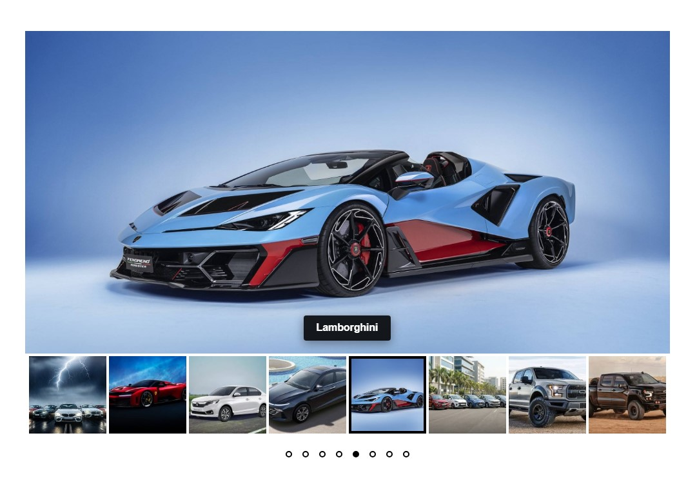

# Ultimate Responsive Image Slider

[](https://github.com/FARAZFRANK/ultimate-responsive-image-slider)
[](https://wordpress.org/plugins/ultimate-responsive-image-slider/)
[](https://www.php.net/)
[](https://www.gnu.org/licenses/gpl-2.0.html)
[](https://wordpress.org/plugins/ultimate-responsive-image-slider/)
[](https://wordpress.org/support/plugin/ultimate-responsive-image-slider/reviews/)

> **Transform your WordPress website with beautiful, responsive, and high-performance image sliders.** Add unlimited slides using Ultimate Responsive Image Slider into any page, post, or template with simple drag-and-drop management and instant shortcode embedding.

---

## 📖 Table of Contents

- [Overview](#-overview)
- [Key Features](#-key-features)
- [Free vs Pro Comparison](#-free-vs-pro-comparison)
- [Requirements](#-requirements)
- [Installation](#-installation)
- [Usage & Integration](#-usage--integration)
- [Configuration & Settings](#-configuration--settings)
- [Supported Languages](#-supported-languages)
- [Screenshots & Previews](#-screenshots--previews)
- [Frequently Asked Questions](#-frequently-asked-questions)
- [Changelog](#-changelog)
- [Contributing](#-contributing)
- [License](#-license)
- [Support & Links](#-support--links)

---

## 🌟 Overview

**Ultimate Responsive Image Slider (URIS)** is a user-friendly and fully responsive slider plugin for WordPress. Whether you are building an e-commerce storefront, portfolio gallery, photography showcase, corporate landing page, or real estate showcase, Ultimate Slider provides a smooth, retina-ready, and lightweight experience without slowing down your website.

- **1.5+ Million Downloads**
- **100,000+ Active WordPress Sites**
- **4.5-Star Community Rating**

---

## ✨ Key Features

### 🎨 Intuitive & Easy to Use
- **Drag-and-Drop Slide Reordering** – Organize your image slides in seconds.
- **WordPress Media Library Integration** – Upload or select existing images effortlessly.
- **One-Click Shortcode** – Copy and paste shortcodes anywhere across your site.
- **Live Preview Support** – Preview how your sliders look before publishing.

### 📱 100% Responsive & Touch-Friendly
- Automatically adjusts dimensions across desktop, tablet, and mobile devices.
- Native swipe and touch gestures enabled for mobile navigation.
- Retina-display support for crisp, high-resolution visuals.
- Fully optimized for Google Core Web Vitals (lightweight script footprint).

### ⚙️ Rich Customization
- **Multiple Navigation Types**: Navigation arrows, pagination bullets, thumbnail previews, or combinations.
- **Transition Effects**: Smooth Fade and Slide transitions with customizable animation duration.
- **Auto-Play Controls**: Enable auto-sliding, set custom slide delay intervals, and pause on hover.
- **Color & Style Controls**: Customize arrow icons, bullets, title overlays, and caption backgrounds.
- **Slide Meta & SEO**: Add slide titles, rich text descriptions, and custom ALT text for search engine optimization.

### 🛠️ Developer Friendly
- Clean, semantic HTML5 output.
- Custom CSS input field in settings for granular styling.
- PHP template tag integration: `<?php echo do_shortcode('[URIS id=123]'); ?>`.
- Translation-ready with `.pot` files included.

---

## 📊 Free vs Pro Comparison

| Feature | Free Version | Pro Version |
| :--- | :---: | :---: |
| **Unlimited Sliders & Slides** | ✅ | ✅ |
| **Responsive & Touch Friendly** | ✅ | ✅ |
| **Drag-and-Drop Image Uploader** | ✅ | ✅ |
| **Thumbnail Navigation Bar** | ✅ | ✅ |
| **Transition Effects** | 2 (Slide & Fade) | 10+ Advanced Animations |
| **Design Layouts** | 1 Standard Layout | 5 Premium Layouts |
| **Clickable Slide Links (URLs)** | ❌ | ✅ |
| **Lightbox Popup Integration** | ❌ | ✅ (2 Lightbox Styles) |
| **Google Fonts Typography** | System / Standard | 500+ Google Fonts |
| **Advanced Slide Ordering** | Asc / Desc | Multiple Custom Sorting Options |
| **Dedicated Priority Support** | WordPress Forum | Priority 1-on-1 Support |

🔗 *Explore the [Pro Version Demo & Features](http://wpfrank.com/demo/ultimate-responsive-image-slider-pro/).*

---

## 💻 Requirements

- **WordPress:** Version 4.0 or higher (Tested up to 6.8+)
- **PHP:** Version 7.0 or higher (Compatible with PHP 8.0, 8.1, 8.2, 8.3+)
- **Modern Browsers:** Chrome, Firefox, Safari, Edge, Opera, and mobile browsers

---

## 🚀 Installation

### Option 1: Via WordPress Admin (Recommended)
1. In your WordPress dashboard, go to **Plugins > Add New**.
2. Search for **"Ultimate Responsive Image Slider"**.
3. Click **Install Now**, then click **Activate**.
4. Access the **Ultimate Slider** menu item in your sidebar.

### Option 2: Via Git / Manual Upload
1. Clone this repository into your WordPress plugin directory:
   ```bash
   cd wp-content/plugins/
   git clone https://github.com/FARAZFRANK/ultimate-responsive-image-slider.git
   ```
2. Alternatively, download the ZIP archive and extract it to:
   `/wp-content/plugins/ultimate-responsive-image-slider/`
3. Activate the plugin via **WordPress Admin > Plugins**.

---

## 🎯 Usage & Integration

### 1. Creating a Slider
1. Navigate to **Ultimate Slider > Add New Slider**.
2. Enter a title for your slider.
3. Click **Add Images** to upload or select photos from your WordPress Media Library.
4. Rearrange images using drag-and-drop.
5. Set optional titles, descriptions, and ALT text for each slide.
6. Configure transition speed, navigation styles, and dimensions.
7. Click **Publish**.

### 2. Displaying via Shortcode
Paste the generated shortcode into any post, page, or widget:
```text
[URIS id=123]
```
*(Replace `123` with your actual slider ID)*

### 3. Displaying in Page Builders
- **Block Editor (Gutenberg):** Insert a **Shortcode** block and paste `[URIS id=123]`.
- **Elementor:** Drag the **Shortcode** widget into your section and paste the shortcode.
- **Divi / Beaver Builder / WPBakery:** Use their respective Code or Shortcode modules.

### 4. Embedding in Theme Template (PHP)
To embed directly within theme templates (such as `header.php`, `front-page.php`, or `footer.php`):
```php
<?php echo do_shortcode('[URIS id=123]'); ?>
```

---

## ⚙️ Comprehensive Settings & Configuration Guide

Ultimate Responsive Image Slider v4.0.0 provides an exhaustive, granular configuration panel organized into intuitive tabs. Below is the complete reference of every single setting, option, and functionality available in the Free edition.

---

### 1. Slide Management & Uploader (`Tab: Add Images`)
* **WordPress Media Library Integration:** Upload new photos or select existing images in bulk directly from your WordPress Media Library.
* **Drag-and-Drop Reordering:** Easily rearrange slide display order by dragging slide cards into your preferred sequence.
* **Per-Slide Title:** Add an optional title overlay for each slide (displays inside the caption card and improves image SEO).
* **Per-Slide Rich-Text Description:** Write formatted slide captions using the built-in WYSIWYG formatting toolbar:
  - **Bold (`B`)** & **Italic (`I`)** text styling.
  - **Hyperlinks:** Insert clickable links with anchor text directly inside descriptions.
  - **Lists:** Bulleted (`UL`) and Numbered (`OL`) list formatting.
  - **Headings:** Format sub-headings (`H3`).
  - **Clear Formatting:** One-click reset to clean unformatted text.
* **Slide Custom Link & Target:** Assign a custom destination URL to any individual slide. Choose whether links open in a **New Tab (`_blank`)** or the **Same Window (`_self`)**.
* **SEO Alt Text Input:** Set dedicated `alt` attributes on every slide image for search engine indexing and screen reader accessibility.
* **Free Vimeo Video Slides:** Embed Vimeo videos directly into your slider:
  - Enter any standard Vimeo URL.
  - **Fetch Thumbnail:** Automatically retrieves and sets the high-resolution Vimeo video cover photo.
  - **Revert:** Instantly restore the original uploaded slide image if needed.
  - **Inline Playback:** Clicking the play icon swaps the image with an inline, responsive Vimeo player.
* **Slide ID Display & Removal:** View individual internal slide IDs and delete unwanted slides with a single click.

---

### 2. Slider Dimensions & Responsive Engine (`Tab: General > Card 3`)
* **Slider Sizing Mode (`width_mode`):**
  - **`Boxed (Container)`:** Fits neatly within your theme's content container or page column width (scales down responsively).
  - **`Full Width`:** Expands edge-to-edge across 100% of the browser viewport with zero horizontal scroll and zero blank gaps.
  - **`Full Screen (Window)`:** Fills 100% of both browser window width and height.
* **Base Canvas Dimensions (`slider_width` × `slider_height`):**
  - Custom pixel inputs with **1px step precision** (`step="1"`), accepting any exact pixel values without HTML5 validation notices.
* **Live Dynamic Aspect Ratio Badge:**
  - Automatically calculates and displays the exact geometric aspect ratio in real time (e.g., `16:9 Widescreen (1.78)`, `4:3 Classic (1.33)`, `Banner / Ultrawide (3.20)`, `1:1 Square (1.00)`).
* **1-Click Quick Presets:**
  - `16:9 Full HD (1920×1080)` — Recommended for widescreen hero banners.
  - `16:9 HD (1280×720)` — Optimal balance of resolution and performance.
  - `4:3 Classic (1024×768)` — Ideal for standard photo portfolios and catalogs.
  - `Banner / Ultrawide (1920×600)` — Perfect for slim header banners.
  - `Square 1:1 (800×800)` — Great for product showcases and Instagram-style galleries.
  - `Use Recommended` — One-click reset to standard optimal dimensions.
* **Height Sizing Mode (`height_mode`):**
  - **`Responsive (Aspect Ratio)`:** Height scales proportionally with width across all desktop, tablet, and mobile devices, preventing any vertical gaps.
  - **`Auto Height (Dynamic)`:** Height automatically expands or shrinks to fit each slide image's natural dimensions (`autoHeight: true`).
  - **`Fixed Height`:** Slider maintains a rigid, fixed pixel height regardless of viewport width changes.
* **Variable Slide Widths (`auto_slide_size`):**
  - Allows slides of varying aspect ratios to sit side-by-side naturally without distortion.

---

### 3. Core Engine, Transitions & Autoplay (`Tab: General > Card 2`)
* **Auto Slideshow (`auto_slideshow`):**
  - **`Auto Play (Continuous)`:** Automatically cycles through slides continuously.
  - **`Pause on Hover`:** Automatically cycles through slides, but pauses when a visitor hovers their cursor over the slider.
  - **`Disable (Manual Navigation)`:** Disables auto-rotation; slides only change when visitors click arrows, bullets, or thumbnails.
* **Transition Speed (`transition_speed`):**
  - Set the autoplay rotation interval in milliseconds (e.g., `5000` = 5 seconds between slides).
* **Slider Transition Effect (`transition_effect`):**
  - **`Slide Animation`:** Smooth horizontal sliding carousel motion between images.
  - **`Fade Animation`:** Elegant cross-fade dissolve opacity transition between slides.
* **Slide Distance (`slide_distance`):**
  - Adjust spacing in pixels between adjacent slides (set `0` for seamless edge-to-edge banners, or `5`, `10`, `20` px for modern card separation).
* **Image Source Size (`image_size`):**
  - Choose which WordPress image crop to load: **Full (Original)**, **Large (max 1024px)**, or **Medium Large (max 768px)**. Using "Large" significantly improves Google Core Web Vitals and mobile loading times.
* **Touch Swipe Sensitivity (`touch_swipe_threshold`):**
  - **High (`25px`):** Fast flick gesture response for mobile devices.
  - **Medium (`50px`):** Balanced, standard gesture response.
  - **Low (`80px`):** Requires a deliberate, firm drag before switching slides.
* **Image Scale Mode (`scale_mode`):**
  - **`cover`:** Fills the entire slide container proportionally, cropping excess edges if ratios differ.
  - **`contain`:** Scales the image so the entire photo is visible without cropping.
  - **`exact`:** Stretches the image to match the container dimensions exactly.
* **Auto Scale Layers (`auto_scale`):**
  - Allows uploaded images smaller than the canvas width to scale up to fit the slider dimensions.
* **Slide Display Order (`slide_order`):**
  - **`ASC` (Ascending):** Slides display in the order uploaded or dragged in the manager.
  - **`DESC` (Descending):** Reverses slide display order.
  - **`shuffle` (Randomized):** Shuffles slide order randomly on every page refresh.

---

### 4. Slide Captions, Typography & Actions (`Tab: Typography & Content`)
* **Content Visibility Toggles:**
  - **`slide_title`:** Show/hide the overall slider title header (`<h3>`) rendered above the slider.
  - **`show_slide_title`:** Toggle individual slide titles inside the caption overlay card.
  - **`show_slide_desc`:** Toggle individual slide descriptions.
* **Typography & Fonts (`font_style`):**
  - Choose from clean web-safe and modern Google font families: *Arial, Georgia, Helvetica, Times New Roman, Tahoma, Verdana, Trebuchet MS, Impact, Open Sans, Roboto, Lato, Montserrat, Oswald*.
  - Live preview box demonstrates font rendering in real time.
* **Caption Colors & Typography Sizing:**
  - **Title Color & Font Size:** Set custom hex color and pixel font size (default `16px`).
  - **Description Color & Font Size:** Set custom hex color and pixel font size (default `14px`).
* **Frosted Caption Card Styling (`bg_color_opacity` & `slide_in_title_bg_color`):**
  - Set custom caption card background color.
  - Adjust background opacity via a live slider from `0.0` (fully transparent) to `1.0` (solid color), creating modern frosted glass overlays.
  - Protected by `data-no-scale` overrides: caption text remains crisp and legible without shrinking when canvas dimensions scale.
* **Text Alignment & Placement (`text_alignment`):**
  - Position the caption card anywhere on the slide: *Bottom Center, Bottom Left, Bottom Right, Top Center, Top Left, Top Right, Center*.
* **Caption Animation Transition (`title_transition`):**
  - Animate captions into view when the active slide changes: *Slide Up, Slide Down, Slide Left, Slide Right*.
* **Call-to-Action (CTA) & Read More Button Styling:**
  - **Button Style (`cta_button_style`):** `Filled` (solid button), `Outline` (ghost button with border), or `Text` (inline text link).
  - **Button Background / Link Color:** Custom color picker (Default `#FFFFFF`).
  - **Button Text Color:** Custom color picker (Default `#000000`).
  - **Hover Background Color:** Custom color picker (Default `#000000`).
  - **Hover Text Color:** Custom color picker (Default `#FFFFFF`).
  - **Read More Placement (`read_more_link_on`):** Display link as a button on the caption card, make the **Entire Slide Image clickable**, or disable links.
  - **Button Label Text (`read_more_link_text`):** Fully customizable label (e.g., "Read More", "Buy Now", "View Portfolio").
  - **Link Open Window (`read_more_link_open`):** Open in New Window (`_blank`) or Same Window (`_self`).

---

### 5. Navigation Controls & Thumbnail Carousel (`Tab: Navigation`)
* **Sliding Navigation Arrows (`sliding_arrow`):**
  - **Show/Hide Arrows:** Toggle navigation arrow buttons on/off.
  - **Arrow Icon Color (`navigation_arrow_color`):** Custom color picker for chevron/caret icons.
  - **Arrow Background Color (`navigation_arrow_bg_color`):** Custom color picker for the arrow circle/pill.
  - **Arrow Shape (`navigation_arrow_radius`):** `Circle` (50% round), `Curved` (8px rounded rectangle), or `Sharp` (0px crisp square).
  - **Arrow Icon Style (`arrow_style`):** Choose between modern `Chevron` or solid triangle `Caret`.
* **Bullet Pagination Dots (`navigation_button`):**
  - **Show/Hide Bullets:** Toggle pagination dot indicator bar below slides.
  - **Bullet Shape (`navigation_button_style`):** `Circle` (50% round dots) or `Square` (0% crisp squares).
  - **Bullet Color (`navigation_button_color`):** Sets border color for inactive dots and solid background for the active selected slide.
  - **Bullet Size (`navigation_button_size`):** Adjust dot diameter in pixels (e.g., `10px`, `12px`, `16px`).
* **Thumbnail Strip Carousel (`detailed_navigation`):**
  - **Show/Hide Thumbnails:** Toggle the interactive thumbnail strip on or off.
  - **Thumbnail Position (`navigation_position`):** Position thumbnail carousel at the **Bottom** (below slide image) or **Top** (above slide image).
  - **Thumbnail Dimensions (`thumbnail_width` × `thumbnail_height`):** Set exact pixel width and height for thumbnail cards (default `120×100 px`).
  - **Thumbnail Active Highlight Style (`thumbnail_style`):**
    - `Border`: Highlights active slide with a crisp 4px solid border.
    - `Pointer`: Adds an elegant directional pointer triangle arrow indicating the active slide.
  - **Selected Thumbnail Border Color (`thumbnail_style_color`):** Custom color picker (default `#000000` classic black).
  - **Thumbnail Caption Colors:** Customize `thumbnail_title_color` and `thumbnail_desc_color`.
* **Fullscreen Presentation Button (`fullscreen`):**
  - Toggle dedicated fullscreen icon button allowing visitors to expand the slider into a distraction-free fullscreen presentation.

---

### 6. Global Settings, Performance & Data Tools (`Admin Menu > Global Settings`)
* **Native Image Lazy Loading (`lazy_load`):**
  - Loads transparent placeholder data and defers off-screen slide images until they enter the viewport, dramatically improving page speed and Lighthouse scores.
* **Anti-FOUC Preloader Spinner (`show_loader`):**
  - Displays a smooth, modern CSS preloader animation with customizable brand accent color (`loader_color`), preventing Flash of Unstyled Content (FOUC) while high-res images load.
* **Selective & Bulk JSON Export (`Import / Export`):**
  - **Selective Export:** Select one, multiple, or all sliders from a list.
  - **One-Click JSON Generation:** Exports portable `.json` backup files containing all slider configurations, slide titles, descriptions, image URLs, and settings.
* **JSON Slider Import & Restore (`Import / Export`):**
  - Upload any URIS export JSON file to instantly restore or clone sliders across different WordPress installations.
  - Features automated WordPress Media Library resolution to map uploaded image URLs seamlessly.

---

### 7. Accessibility, SEO & Developer Features
* **WCAG 2.1 AA Keyboard Navigation:** Navigate slides effortlessly using `ArrowLeft`, `ArrowRight`, `Space`, and `Enter` keys.
* **Screen Reader Accessibility:** Includes `role="region"`, `aria-roledescription="carousel"`, labeled arrow and thumbnail controls, and dynamic live screen-reader slide announcements (`Slide X of Y: Title`).
* **Universal Shortcode Aliases:**
  - Standard: `[URIS id=123]`
  - Lowercase: `[uris id=123]`
  - Pro Alias: `[URISP id=123]`
  - Extended: `[ultimate-responsive-image-slider id=123]`
* **Theme PHP Template Tag:**
  ```php
  <?php echo do_shortcode('[URIS id=123]'); ?>
  ```
* **Page Builder Support:** 100% compatible with Gutenberg Shortcode block, Elementor Shortcode widget, Divi Code module, Beaver Builder, WPBakery, and all major WordPress builders.

---

## 🌍 Supported Languages

The plugin comes localized and translation-ready. Included translation files:
- Arabic (`ar`)
- Chinese (`zh_CN`)
- Dutch (`nl_NL`)
- Finnish (`fi_FI`)
- French (`fr_FR`)
- German (`de_DE`)
- Hindi (`hi_IN`)
- Hungarian (`hu_HU`)
- Indonesian (`id_ID`)
- Italian (`it_IT`)
- Japanese (`ja_JP`)
- Polish (`pl_PL`)
- Portuguese (`pt_PT`)
- Russian (`ru_RU`)
- Spanish (`es_ES`)

*Translation contributions are welcome via Pull Requests or the `.pot` template.*

---

## 🖼️ Screenshots & Previews

| Header Slider Example | Inline Slider Within Content |
| :---: | :---: |
|  |  |

---


## ❓ Frequently Asked Questions

### Is this plugin compatible with the top 15 WordPress themes?
Yes! Ultimate Responsive Image Slider is 100% compatible and tested with the top 15 popular WordPress themes (excluding default WordPress Twenty-series themes). It runs smoothly without CSS or layout conflicts across:
1. **Astra**
2. **OceanWP**
3. **GeneratePress**
4. **Kadence**
5. **Neve**
6. **Hello Elementor**
7. **Divi**
8. **Avada**
9. **Blocksy**
10. **Sydney**
11. **Flatsome**
12. **Hestia**
13. **ColorMag**
14. **Enfold**
15. **Zakra**

Whether your theme is a lightweight block theme, multipurpose builder theme, or WooCommerce storefront, the slider conforms cleanly to your page containers and layout widths.

---

## 📝 Changelog

### **v4.0.0** *(Current Release - November 13, 2026)*
- 📐 **Slider Dimensions & Responsive Engine Redesign**: Re-engineered canvas sizing with dedicated Sizing Modes (Boxed, Full Width, Full Screen Window), Height Modes (Responsive Aspect Ratio, Auto Height Dynamic, Fixed Height), and Variable Slide Widths (`autoSlideSize`).
- ⚡ **Aspect Ratio Presets & Real-Time Badge**: Added 1-click Quick Presets (`1920×1080`, `1280×720`, `1024×768`, `1920×600`, `800×800`) with dynamic live aspect ratio calculation and informative hints.
- 🛠️ **Full Width Gap Elimination**: Completely eliminated the large blank space between the slide image and thumbnail strip in Full Width mode by properly passing base canvas dimensions and calculated aspect ratios to the SliderPro engine.
- 🔤 **Caption Typography Scaling Fix**: Resolved slide title and description font auto-scaling issues when slider dimensions change using no-scale overrides for crisp, legible captions across all screen sizes.
- ✅ **HTML5 Input Validation**: Fixed browser validation tooltip warnings when entering non-multiple-of-10 dimensions (such as `1024×768`) by adjusting input step increments.
- 📦 **Unlocked Import & Export System**: Fully unlocked selective and bulk JSON Import & Export tools in Global Settings with automated media library resolution and cross-version compatibility.
- 🎬 **Slide Animation Fix**: Resolved Slider Transition Effect where "Slide Animation" was inadvertently overridden by fade animation due to PHP empty check.
- 📌 **Sticky Tabs & Tab Persistence**: Made the slider configuration tab bar sticky on scroll and added server-side tab state persistence upon saving.
- 🎨 **Beautified Admin Dialogs**: Replaced native browser alert and confirm popups with modern, accessible modal cards and toast notifications.
- 🖼️ **Thumbnail Styling**: Defaulted selected slide thumbnail active border color to classic black (`#000000`) with backward-compatible legacy pointer color synchronization.
- 🎯 **Button & Link Color Defaults**: Configured default button/link styling to high-contrast monochrome (White button with Black text, inverted on hover).
- ⚡ **Anti-FOUC & Loading Guard**: Implemented `sp-no-js` pre-initialization state and transparent image placeholders, eliminating multi-loader flickering and floating caption cards on load.
- 🏗️ **Modern Modular Architecture**: Refactored codebase into clean, modular components (`admin/`, `includes/`, `layouts/`).

### **v3.5.20** *(October 28, 2026)*
- 🔄 **Database Version Tracking**: Added automated DB versioning (`uris_plugin_version`, `uris_db_version`) and upgrade migration hooks for future updates.
- 📐 **Overlap Fix**: Resolved Slide Title and Description collision on multi-line text using dynamic unified flexbox layout.
- 🔘 **Navigation Dots & Bullets**: Fixed pagination dots gap, alignment, and hover styling.
- 🎨 **Visual Styling**: Corrected slide title background opacity and contrast visibility.
- ⏹️ **Sharp Slide Corners**: Enforced crisp 0px border radius on slide images and masks.
- 🌐 **Theme Layout Harmony**: Eliminated outer wrapper conflicts, restoring full native theme width and exact slider sizing.
- 🛡️ **100% Backward Compatibility**: Verified and seamless upgrade from v3.5.19 for 30,000+ active installations.

### **v3.5.19**
- 🔒 **Security Hardening**: Resolved all WordPress Plugin Check notices and warnings.
- 🛡️ Enhanced input sanitization and output escaping.
- 🚀 Verified compatibility up to WordPress 6.8+.
- 🔔 Added critical update notices and security advisories.

*For complete version history, refer to [readme.txt](readme.txt).*

---

## 🤝 Contributing

Contributions, bug reports, and feature requests are welcome!
1. Fork the Project.
2. Create your Feature Branch (`git checkout -b feature/AmazingFeature`).
3. Commit your Changes (`git commit -m 'Add some AmazingFeature'`).
4. Push to the Branch (`git push origin feature/AmazingFeature`).
5. Open a Pull Request.

---

## 📄 License

Distributed under the **GNU General Public License v2.0 or later (GPL-2.0-or-later)**.
See the [GNU General Public License](https://www.gnu.org/licenses/gpl-2.0.html) for full details.

---

## 👤 Author & Support

- **Author:** [FARAZFRANK](https://profiles.wordpress.org/farazfrank/)
- **Website:** [WPFrank](http://wpfrank.com/)
- **Plugin Forum:** [WordPress.org Support](https://wordpress.org/support/plugin/ultimate-responsive-image-slider/)
- **Video Tutorial:** [Watch on YouTube](https://www.youtube.com/watch?v=PzaAXzy21U4)

---
*Maintained with ❤️ by FARAZFRANK & the WPFrank Team.*
