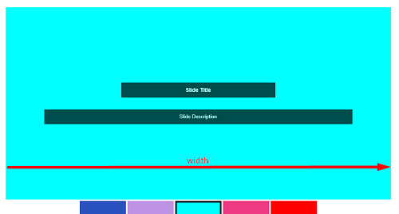
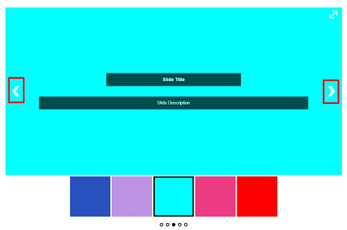
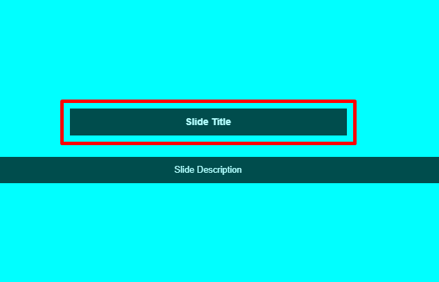

# Ultimate Responsive Image Slider

[](https://github.com/FARAZFRANK/ultimate-responsive-image-slider)
[](https://wordpress.org/plugins/ultimate-responsive-image-slider/)
[](https://www.php.net/)
[](https://www.gnu.org/licenses/gpl-2.0.html)
[](https://wordpress.org/plugins/ultimate-responsive-image-slider/)
[](https://wordpress.org/support/plugin/ultimate-responsive-image-slider/reviews/)

> **Transform your WordPress website with beautiful, responsive, and high-performance image sliders.** Add unlimited slides using Ultimate Responsive Image Slider into any page, post, or template with simple drag-and-drop management and instant shortcode embedding.

---

## 📖 Table of Contents

- [Overview](#-overview)
- [Key Features](#-key-features)
- [Free vs Pro Comparison](#-free-vs-pro-comparison)
- [Requirements](#-requirements)
- [Installation](#-installation)
- [Usage & Integration](#-usage--integration)
- [Configuration & Settings](#-configuration--settings)
- [Supported Languages](#-supported-languages)
- [Screenshots & Previews](#-screenshots--previews)
- [Frequently Asked Questions](#-frequently-asked-questions)
- [Changelog](#-changelog)
- [Contributing](#-contributing)
- [License](#-license)
- [Support & Links](#-support--links)

---

## 🌟 Overview

**Ultimate Responsive Image Slider (URIS)** is a user-friendly and fully responsive slider plugin for WordPress. Whether you are building an e-commerce storefront, portfolio gallery, photography showcase, corporate landing page, or real estate showcase, Ultimate Slider provides a smooth, retina-ready, and lightweight experience without slowing down your website.

- **1.5+ Million Downloads**
- **100,000+ Active WordPress Sites**
- **4.5-Star Community Rating**

---

## ✨ Key Features

### 🎨 Intuitive & Easy to Use
- **Drag-and-Drop Slide Reordering** – Organize your image slides in seconds.
- **WordPress Media Library Integration** – Upload or select existing images effortlessly.
- **One-Click Shortcode** – Copy and paste shortcodes anywhere across your site.
- **Live Preview Support** – Preview how your sliders look before publishing.

### 📱 100% Responsive & Touch-Friendly
- Automatically adjusts dimensions across desktop, tablet, and mobile devices.
- Native swipe and touch gestures enabled for mobile navigation.
- Retina-display support for crisp, high-resolution visuals.
- Fully optimized for Google Core Web Vitals (lightweight script footprint).

### ⚙️ Rich Customization
- **Multiple Navigation Types**: Navigation arrows, pagination bullets, thumbnail previews, or combinations.
- **Transition Effects**: Smooth Fade and Slide transitions with customizable animation duration.
- **Auto-Play Controls**: Enable auto-sliding, set custom slide delay intervals, and pause on hover.
- **Color & Style Controls**: Customize arrow icons, bullets, title overlays, and caption backgrounds.
- **Slide Meta & SEO**: Add slide titles, rich text descriptions, and custom ALT text for search engine optimization.

### 🛠️ Developer Friendly
- Clean, semantic HTML5 output.
- Custom CSS input field in settings for granular styling.
- PHP template tag integration: `<?php echo do_shortcode('[URIS id=123]'); ?>`.
- Translation-ready with `.pot` files included.

---

## 📊 Free vs Pro Comparison

| Feature | Free Version | Pro Version |
| :--- | :---: | :---: |
| **Unlimited Sliders & Slides** | ✅ | ✅ |
| **Responsive & Touch Friendly** | ✅ | ✅ |
| **Drag-and-Drop Image Uploader** | ✅ | ✅ |
| **Thumbnail Navigation Bar** | ✅ | ✅ |
| **Transition Effects** | 2 (Slide & Fade) | 10+ Advanced Animations |
| **Design Layouts** | 1 Standard Layout | 5 Premium Layouts |
| **Clickable Slide Links (URLs)** | ❌ | ✅ |
| **Lightbox Popup Integration** | ❌ | ✅ (2 Lightbox Styles) |
| **Google Fonts Typography** | System / Standard | 500+ Google Fonts |
| **Advanced Slide Ordering** | Asc / Desc | Multiple Custom Sorting Options |
| **Dedicated Priority Support** | WordPress Forum | Priority 1-on-1 Support |

🔗 *Explore the [Pro Version Demo & Features](http://wpfrank.com/demo/ultimate-responsive-image-slider-pro/).*

---

## 💻 Requirements

- **WordPress:** Version 4.0 or higher (Tested up to 6.8+)
- **PHP:** Version 7.0 or higher (Compatible with PHP 8.0, 8.1, 8.2, 8.3+)
- **Modern Browsers:** Chrome, Firefox, Safari, Edge, Opera, and mobile browsers

---

## 🚀 Installation

### Option 1: Via WordPress Admin (Recommended)
1. In your WordPress dashboard, go to **Plugins > Add New**.
2. Search for **"Ultimate Responsive Image Slider"**.
3. Click **Install Now**, then click **Activate**.
4. Access the **Ultimate Slider** menu item in your sidebar.

### Option 2: Via Git / Manual Upload
1. Clone this repository into your WordPress plugin directory:
   ```bash
   cd wp-content/plugins/
   git clone https://github.com/FARAZFRANK/ultimate-responsive-image-slider.git
   ```
2. Alternatively, download the ZIP archive and extract it to:
   `/wp-content/plugins/ultimate-responsive-image-slider/`
3. Activate the plugin via **WordPress Admin > Plugins**.

---

## 🎯 Usage & Integration

### 1. Creating a Slider
1. Navigate to **Ultimate Slider > Add New Slider**.
2. Enter a title for your slider.
3. Click **Add Images** to upload or select photos from your WordPress Media Library.
4. Rearrange images using drag-and-drop.
5. Set optional titles, descriptions, and ALT text for each slide.
6. Configure transition speed, navigation styles, and dimensions.
7. Click **Publish**.

### 2. Displaying via Shortcode
Paste the generated shortcode into any post, page, or widget:
```text
[URIS id=123]
```
*(Replace `123` with your actual slider ID)*

### 3. Displaying in Page Builders
- **Block Editor (Gutenberg):** Insert a **Shortcode** block and paste `[URIS id=123]`.
- **Elementor:** Drag the **Shortcode** widget into your section and paste the shortcode.
- **Divi / Beaver Builder / WPBakery:** Use their respective Code or Shortcode modules.

### 4. Embedding in Theme Template (PHP)
To embed directly within theme templates (such as `header.php`, `front-page.php`, or `footer.php`):
```php
<?php echo do_shortcode('[URIS id=123]'); ?>
```

---

## ⚙️ Configuration & Settings

Ultimate Responsive Image Slider offers granular configuration options:

| Setting Category | Description |
| :--- | :--- |
| **Slider Dimensions** | Set custom width and height (px / %) for desktop and responsive scaling. |
| **Slide Transition** | Choose between `Slide` and `Fade` animations. |
| **Transition Speed** | Configure autoplay timing (default 5000ms / 5s). |
| **Navigation Controls** | Show/hide navigation arrows, bullet dots, and thumbnail navigation. |
| **Thumbnail Styles** | Configure thumbnail size, positioning (bottom/top), and active borders. |
| **Color Schemes** | Customize arrow colors, active bullet colors, and caption backgrounds. |
| **Slide Text Overlays** | Toggle display of slide title and rich descriptions. |
| **Custom CSS** | Inject custom CSS declarations directly without touching theme files. |

---

## 🌍 Supported Languages

The plugin comes localized and translation-ready. Included translation files:
- Arabic (`ar`)
- Chinese (`zh_CN`)
- Dutch (`nl_NL`)
- Finnish (`fi_FI`)
- French (`fr_FR`)
- German (`de_DE`)
- Hindi (`hi_IN`)
- Hungarian (`hu_HU`)
- Indonesian (`id_ID`)
- Italian (`it_IT`)
- Japanese (`ja_JP`)
- Polish (`pl_PL`)
- Portuguese (`pt_PT`)
- Russian (`ru_RU`)
- Spanish (`es_ES`)

*Translation contributions are welcome via Pull Requests or the `.pot` template.*

---

## 🖼️ Screenshots & Previews

| Header / Hero Slider | Thumbnail Carousel Navigation |
| :---: | :---: |
|  |  |

| Navigation & Controls | Slide Titles & Overlays |
| :---: | :---: |
|  |  |

---


## ❓ Frequently Asked Questions

### Is this plugin compatible with the top 15 WordPress themes?
Yes! Ultimate Responsive Image Slider is 100% compatible and tested with the top 15 popular WordPress themes (excluding default WordPress Twenty-series themes). It runs smoothly without CSS or layout conflicts across:
1. **Astra**
2. **OceanWP**
3. **GeneratePress**
4. **Kadence**
5. **Neve**
6. **Hello Elementor**
7. **Divi**
8. **Avada**
9. **Blocksy**
10. **Sydney**
11. **Flatsome**
12. **Hestia**
13. **ColorMag**
14. **Enfold**
15. **Zakra**

Whether your theme is a lightweight block theme, multipurpose builder theme, or WooCommerce storefront, the slider conforms cleanly to your page containers and layout widths.

---

## 📝 Changelog

### **v3.5.20** *(Current Release - October 28, 2026)*
- 🔄 **Database Version Tracking**: Added automated DB versioning (`uris_plugin_version`, `uris_db_version`) and upgrade migration hooks for future updates.
- 📐 **Overlap Fix**: Resolved Slide Title and Description collision on multi-line text using dynamic unified flexbox layout.
- 🔘 **Navigation Dots & Bullets**: Fixed pagination dots gap, alignment, and hover styling.
- 🎨 **Visual Styling**: Corrected slide title background opacity and contrast visibility.
- ⏹️ **Sharp Slide Corners**: Enforced crisp 0px border radius on slide images and masks.
- 🌐 **Theme Layout Harmony**: Eliminated outer wrapper conflicts, restoring full native theme width and exact slider sizing.
- 🛡️ **100% Backward Compatibility**: Verified and seamless upgrade from v3.5.19 for 30,000+ active installations.

### **v3.5.19**
- 🔒 **Security Hardening**: Resolved all WordPress Plugin Check notices and warnings.
- 🛡️ Enhanced input sanitization and output escaping.
- 🚀 Verified compatibility up to WordPress 6.8+.
- 🔔 Added critical update notices and security advisories.

*For complete version history, refer to [readme.txt](readme.txt).*

---

## 🤝 Contributing

Contributions, bug reports, and feature requests are welcome!
1. Fork the Project.
2. Create your Feature Branch (`git checkout -b feature/AmazingFeature`).
3. Commit your Changes (`git commit -m 'Add some AmazingFeature'`).
4. Push to the Branch (`git push origin feature/AmazingFeature`).
5. Open a Pull Request.

---

## 📄 License

Distributed under the **GNU General Public License v2.0 or later (GPL-2.0-or-later)**.
See the [GNU General Public License](https://www.gnu.org/licenses/gpl-2.0.html) for full details.

---

## 👤 Author & Support

- **Author:** [FARAZFRANK](https://profiles.wordpress.org/farazfrank/)
- **Website:** [WPFrank](http://wpfrank.com/)
- **Plugin Forum:** [WordPress.org Support](https://wordpress.org/support/plugin/ultimate-responsive-image-slider/)
- **Video Tutorial:** [Watch on YouTube](https://www.youtube.com/watch?v=PzaAXzy21U4)

---
*Maintained with ❤️ by FARAZFRANK & the WPFrank Team.*
